# Architecture — CodeShop

## 1. System Context

CodeShop adalah sistem marketplace digital yang berinteraksi dengan:

- **Buyer/Guest** melalui web client.
- **Payment Provider** pihak ketiga (menerima pembayaran, mengirim webhook status).
- **Email/Notification Provider** pihak ketiga (SMTP/email API) untuk mengirim notifikasi.
- **Object Storage** (MinIO/S3-compatible) sebagai tempat penyimpanan file produk digital.

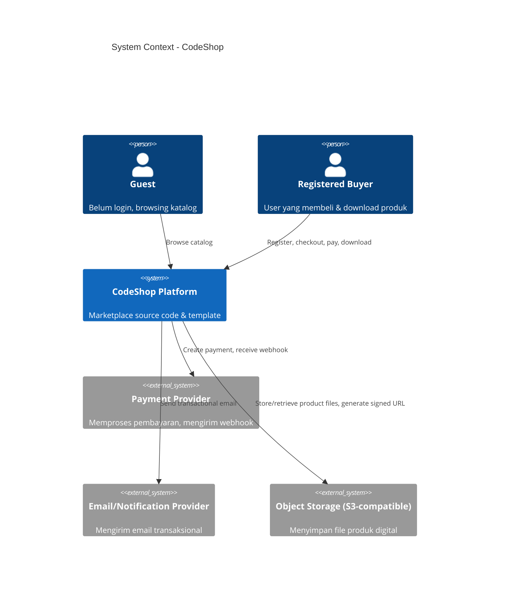

## 2. High-Level Architecture

CodeShop dibangun sebagai **microservices** dengan API Gateway sebagai satu-satunya entry point publik. Setiap service memiliki database sendiri (database-per-service). Komunikasi internal menggunakan gRPC untuk synchronous call dan RabbitMQ untuk asynchronous event.

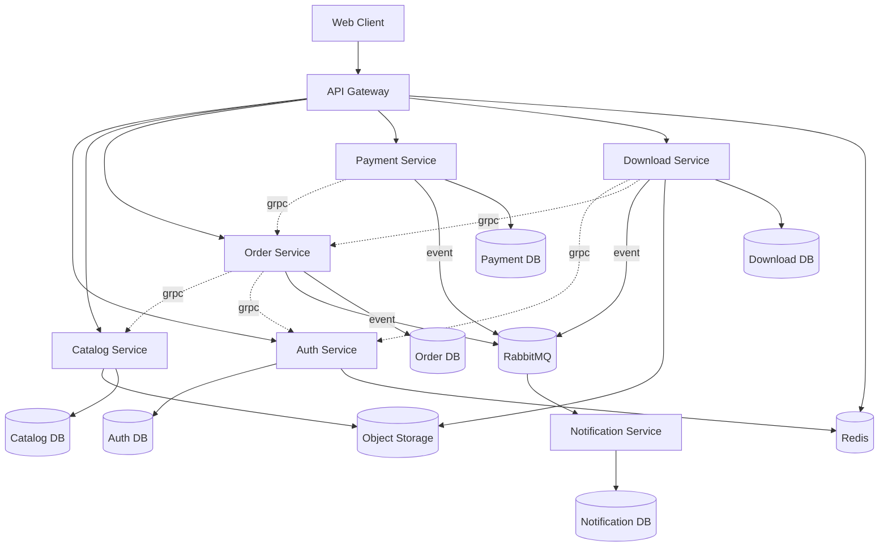

## 3. Service Architecture

Baseline service yang dievaluasi:

```text
API Gateway
Auth Service
Catalog Service
Order Service
Payment Service
Download Service
Notification Service
```

**Evaluasi**: baseline ini dipertahankan untuk MVP. Pertimbangan yang dievaluasi dan ditolak:

- **Cart sebagai service terpisah** — ditolak. Cart bersifat state sederhana dan berumur pendek (ephemeral), lebih tepat disimpan sebagai bagian dari Order Service (status `DRAFT`) atau di client-side/Redis, bukan service gRPC/database tersendiri. Membuat Cart Service terpisah menambah satu network hop dan satu database tanpa manfaat isolasi domain yang signifikan pada skala MVP. Cart didokumentasikan sebagai **sub-domain di dalam Order Service** (lihat `SERVICE_CATALOG.md`).
- **Product Version sebagai service terpisah** — ditolak, tetap menjadi bagian dari Catalog Service karena siklus hidup dan ownership data-nya melekat pada produk.
- **Search Service terpisah (mis. Elasticsearch-backed)** — ditolak untuk MVP, akan dipertimbangkan di Phase 2 jika volume katalog besar. Untuk MVP, pencarian dilakukan melalui query PostgreSQL di Catalog Service.

Detail tiap service ada di `SERVICE_CATALOG.md`.

## 4. Trust Boundaries

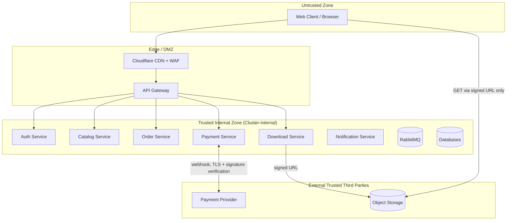

Prinsip: hanya API Gateway yang dapat diakses dari luar cluster. Seluruh service internal tidak memiliki exposure publik. Object storage tidak pernah diakses langsung menggunakan credential permanen oleh client — hanya melalui signed URL berumur pendek.

> Diagram di atas adalah ringkasan trust boundary di level aplikasi. Peta trust boundary lengkap — termasuk CI/CD, Container Registry, dan Kubernetes Control Plane sebagai zona highly-sensitive tersendiri — didokumentasikan di `NETWORK_DESIGN.md` §3 dan `THREAT_MODEL.md` §Infrastructure.

## 5. Security Boundaries

- **Public boundary**: Client ↔ API Gateway (TLS, rate limiting, WAF via Cloudflare).
- **Service boundary**: antar service internal menggunakan mTLS/NetworkPolicy dalam cluster (konsep, detail implementasi di Phase 2/3).
- **Data boundary**: setiap service hanya boleh mengakses database miliknya sendiri; tidak ada shared database.
- **Storage boundary**: object storage private, hanya dapat diakses via signed URL yang diterbitkan Download Service.

## 6. Network Boundaries

- Public-facing: API Gateway (di belakang Cloudflare).
- Cluster-internal only: seluruh backend service, database, Redis, RabbitMQ.
- Object storage: private bucket, network policy membatasi akses hanya dari Download/Catalog Service untuk operasi manajemen; akses publik hanya melalui signed URL.

## 7. Communication Patterns

### Synchronous (gRPC / REST)

Digunakan ketika caller membutuhkan response langsung untuk melanjutkan alur (mis. validasi ownership sebelum generate signed URL).

| Caller | Callee | Protokol | Alasan |
|---|---|---|---|
| API Gateway | Semua service | REST (public) → gRPC (internal) | Entry point publik |
| Order Service | Catalog Service | gRPC | Validasi produk & harga saat checkout |
| Order Service | Auth Service | gRPC | Validasi identitas user |
| Payment Service | Order Service | gRPC | Update status order setelah verifikasi |
| Download Service | Auth Service | gRPC | Validasi token/identitas |
| Download Service | Order Service | gRPC | Cek kepemilikan order/entitlement |

### Asynchronous (RabbitMQ Event)

Digunakan untuk efek samping yang tidak perlu diketahui hasilnya secara langsung oleh pengirim (fire-and-forget dengan guarantee delivery), dan untuk decoupling antar domain.

| Event Producer | Event | Consumer |
|---|---|---|
| Order Service | `OrderCreated` | Notification Service |
| Payment Service | `OrderPaid` | Download Service, Notification Service |
| Payment Service | `PaymentFailed` | Notification Service |
| Download Service | `DownloadGranted` | Notification Service |

Detail lengkap di `EVENT_DESIGN.md`.

## 8. Checkout Flow

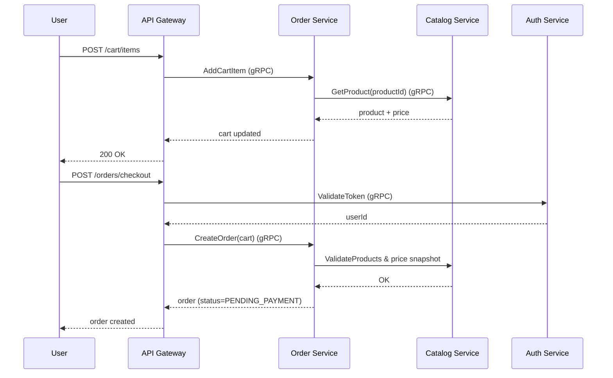

## 9. Payment Flow

> **Ownership correction (Phase 1.1):** Payment Service owns only the *payment* lifecycle (`Payment`, `PaymentTransaction`, `ProviderReference`). Order Service owns the *order* lifecycle (`Order`, `OrderStatus`). Payment Service **does not** call `UpdateOrderStatus` directly and **does not** decide when an order becomes `PAID`. Instead, Payment Service publishes `PaymentSucceeded`/`PaymentFailed` as the authoritative statement about the *payment*, and Order Service — as the sole owner of order state — consumes that event and decides the resulting order transition. This keeps each service the single writer of its own state, consistent with `SERVICE_CATALOG.md` §3–§5 and `ADR-013`-adjacent correction documented in `EVENT_DESIGN.md` §1a.

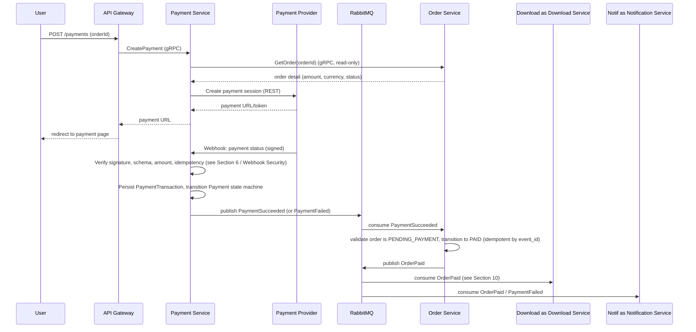

This design deliberately trades a small amount of latency (order becomes `PAID` a moment after payment is confirmed, not in the same transaction) for **clean ownership boundaries**: Payment Service never mutates data it does not own, and Order Service never has to understand payment-provider semantics. The consistency window is bounded and monitored (see `RELIABILITY.md` and `OBSERVABILITY.md`).

### Failure and edge-case handling

| Scenario | Handling |
|---|---|
| Duplicate webhook (provider retries) | `ProviderReference` unique constraint + idempotency check in Payment Service rejects/no-ops the duplicate before any state change (see `DATABASE_DESIGN.md` and `THREAT_MODEL.md`). |
| Out-of-order webhook (e.g. `FAILED` arrives after `SUCCEEDED` due to provider retry race) | Payment state machine (Section 9a) only allows transitions from valid current states; a `FAILED` webhook received while `Payment` is already `SUCCEEDED` is logged as an anomaly and ignored, not blindly applied. |
| Webhook replay (attacker resends an old valid-looking payload) | Timestamp validation + idempotency key + signature binding to the original transaction (see `THREAT_MODEL.md`, Payment threats). |
| Payment timeout (user abandons checkout) | Payment transitions `PENDING → EXPIRED` after a configured timeout; Order Service independently expires `PENDING_PAYMENT` orders that receive no `PaymentSucceeded` within a timeout window (belt-and-suspenders, not a hard dependency on Payment Service's timer). |
| Provider downtime | Payment Service surfaces `PAYMENT_PROVIDER_ERROR` to the user at creation time; for webhook delivery gaps, a periodic **reconciliation job** (Payment Service polls provider status API for transactions stuck in `PENDING` beyond a threshold) is the documented mitigation — not implemented in Phase 1. |
| `OrderPaid` event lost (RabbitMQ issue) | Order Service state (`PAID`) is already durable in Order DB; the event is for *downstream* consumers (Download, Notification). If lost, it is recoverable via DLQ replay or a reconciliation query (Download Service can periodically check for `PAID` orders without an entitlement) — documented as an operational safety net in `RELIABILITY.md`. |

### Authoritative state

- **Authoritative state for a payment** = `Payment.status` in Payment DB, driven only by verified webhook events (or reconciliation against the provider).
- **Authoritative state for an order** = `Order.status` in Order DB, driven only by Order Service's own logic in response to `PaymentSucceeded`/`PaymentFailed` events (or explicit admin/refund actions in later phases).
- No other service is permitted to write either field.

## 10. Download Flow

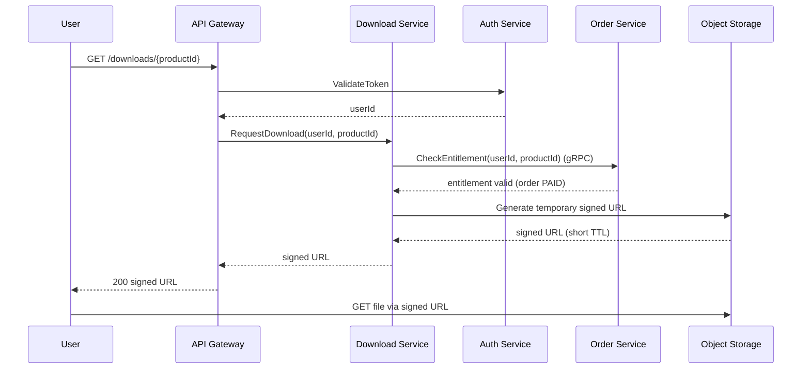

**Download policy check** (added between entitlement check and signed URL generation): Download Service also verifies the entitlement has not been revoked (e.g. due to a refund, chargeback, or product takedown) and that any per-user/per-product download-rate policy has not been exceeded, before issuing a signed URL. See `THREAT_MODEL.md` (Download threats) for the abuse cases this defends against, and Section 9's ADR-009 cross-reference for the accepted limitation that a still-valid signed URL can technically be shared.

**Entitlement revocation**: a `DownloadEntitlement.status` transition to `REVOKED` (triggered by refund completion in Phase 2, or an admin/legal takedown at any phase) immediately stops new signed URLs from being issued for that entitlement; URLs already issued and still within their TTL remain valid for their remaining lifetime (bounded exposure — this is why the TTL is kept short, per ADR-009). Revocation does not attempt to invalidate a URL already handed to the client mid-flight, which is a known, accepted trade-off of the signed-URL model.

## 11. Authentication Flow

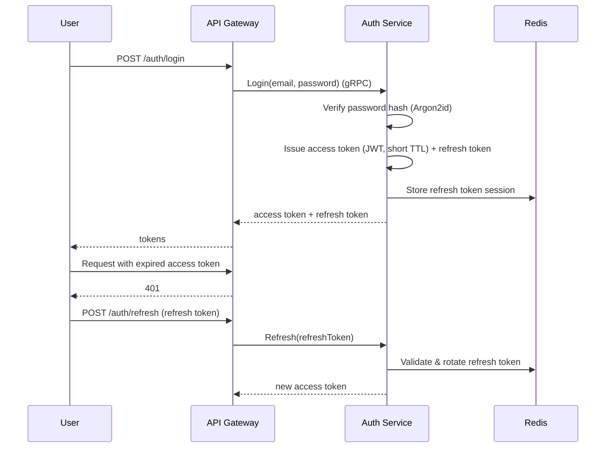

## 11a. Authorization Boundary

**The API Gateway is not the ultimate authorization authority.** This is stated explicitly because it is a common architectural mistake to push authorization logic into the gateway layer, which then becomes a shared, growing, hard-to-audit rule engine that every service implicitly trusts.

The Gateway's responsibilities stop at:

- TLS termination
- Routing
- Rate limiting
- Request ID / correlation ID injection
- Request size limits
- **Coarse authentication enforcement** — rejecting requests with no token or a structurally invalid/expired JWT before they reach a backend service (cheap, cacheable check).

Everything beyond "is this a validly-signed, non-expired token" — i.e. **business authorization** ("does this user own this order", "is this order PAID", "is this admin allowed to deactivate this product") — is decided exclusively by the owning service, using data it owns.

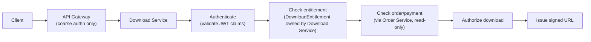

**Rationale**: this keeps authorization logic co-located with the data it depends on (ownership-based authorization, per `REQUIREMENTS.md` §8), avoids the Gateway becoming a second source of truth, and means a bug or bypass at the Gateway cannot, by itself, grant unauthorized access to a downstream resource — every service re-validates its own boundary. This principle is applied consistently across Order, Payment, and Download Service and is reflected in `SERVICE_CATALOG.md` and `THREAT_MODEL.md` (Broken Authorization / IDOR entries).

## 11b. Payment and Order State Machines

Following the ownership correction in Section 9, Payment and Order each own an independent state machine. Neither service is allowed to set the other's state directly.

### Payment State Machine (owned by Payment Service)

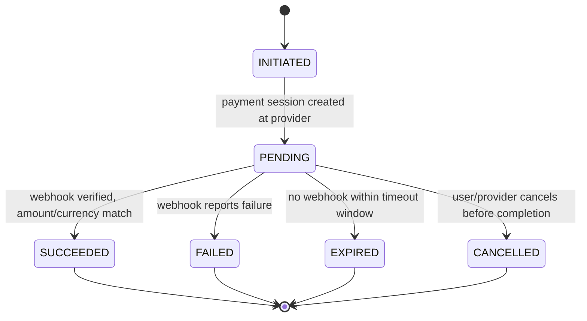

**Valid transitions only from `PENDING`** to a terminal state. A webhook attempting to move a payment that is already `SUCCEEDED`, `FAILED`, `EXPIRED`, or `CANCELLED` to any other state is rejected and logged as an anomaly (see out-of-order webhook handling, Section 9). `INITIATED → SUCCEEDED` directly (skipping `PENDING`) is also treated as invalid/anomalous, since it implies a webhook arrived before the provider session was even confirmed created.

### Order State Machine (owned by Order Service)

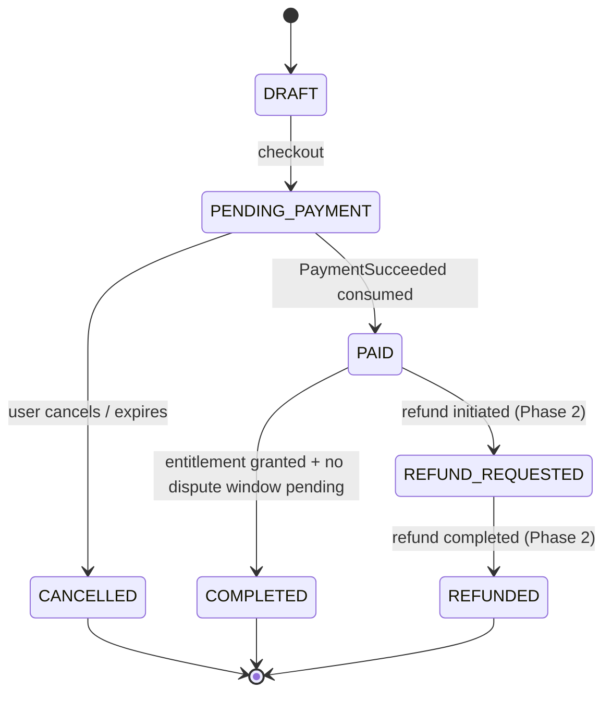

**Notes**:
- `DRAFT` corresponds to the cart sub-domain (see `SERVICE_CATALOG.md` §4 and `ARCHITECTURE.md` §3).
- `PENDING_PAYMENT → PAID` is the **only** transition triggered by an external event (`PaymentSucceeded`), and it is idempotent (processing the same event twice must not re-trigger downstream effects — see `EVENT_DESIGN.md` §8).
- `PENDING_PAYMENT → CANCELLED` covers both explicit user cancellation and the timeout-based expiry described in Section 9's failure table. This is Order Service's own timer, independent of Payment Service's `EXPIRED` state — the two are correlated in practice but not causally coupled, which is intentional (Order Service must not depend on Payment Service telling it to expire).
- `PAID → COMPLETED` is a bookkeeping transition (MVP may treat `PAID` and `COMPLETED` as equivalent for entitlement purposes; the distinction becomes meaningful once a dispute/refund window is introduced in Phase 2).
- Refund states are documented here for completeness of the state machine shape, but refund *processing* remains Phase 2 scope (see `REQUIREMENTS.md`).
- Any transition not drawn above (e.g. `CANCELLED → PAID`, `COMPLETED → PENDING_PAYMENT`) is invalid and must be rejected by Order Service at the application layer, not merely assumed impossible.

## 12. Failure Scenarios

| Skenario | Dampak | Mitigasi |
|---|---|---|
| Payment webhook gagal diterima | Order tetap `PENDING_PAYMENT` walau user sudah bayar | Payment provider melakukan retry webhook; Payment Service juga menyediakan reconciliation job (polling status ke provider) sebagai fallback — didokumentasikan sebagai kebutuhan, bukan implementasi. |
| RabbitMQ down saat `OrderPaid` dipublish | Download entitlement tertunda | Payment Service tetap mengubah status order (source of truth di DB), event dipublish ulang dengan retry/outbox pattern. |
| Object Storage tidak dapat diakses | Signed URL gagal dibuat/gagal diakses | Download Service mengembalikan error jelas; retry di sisi client; observability alert. |
| Notification Service down | Email tidak terkirim | Tidak menggagalkan alur utama (checkout/payment/download tetap berjalan); event tetap di queue untuk diproses saat service pulih. |
| Auth Service down | Seluruh service yang butuh validasi token terganggu | Auth adalah dependency kritikal; didesain untuk high availability (multiple replica) dan token JWT tetap dapat divalidasi secara stateless (signature) tanpa selalu memanggil Auth Service — lihat `API_DESIGN.md`. |

## 13. Storage Architecture

- **Relational data**: PostgreSQL, satu instance/skema logis per service (database-per-service).
- **Cache/session**: Redis — digunakan untuk cache katalog (read-heavy), session/refresh token, dan rate limiting counter.
- **Message broker**: RabbitMQ — untuk event asynchronous antar service.
- **Object storage**: MinIO/S3-compatible — menyimpan file produk digital di private bucket, tidak pernah diakses langsung oleh client kecuali melalui signed URL.

## 14. Scalability

- API Gateway dan Catalog Service (read-heavy) di-scale horizontal terlebih dahulu.
- Download Service di-scale berdasarkan concurrency permintaan signed URL, bukan berdasarkan bandwidth file (karena transfer file terjadi langsung antara client dan object storage, bukan melalui service).
- Database per service memungkinkan scaling storage/index secara independen sesuai beban masing-masing domain.

## 15. Reliability

Lihat detail di `RELIABILITY` section pada dokumen ini level project — didokumentasikan lebih lanjut sebagai bagian dari operational readiness, mencakup retry, timeout, circuit breaker, dan idempotency di level design (bukan kode).

## 16. Observability

Setiap service didesain untuk mengekspos metrics, logs terstruktur, dan traces yang dapat dikorelasikan menggunakan correlation ID/trace ID lintas service. Detail lengkap (golden signals, SLI/SLO, dashboard, alerting) sekarang didokumentasikan sebagai dokumen tersendiri: `OBSERVABILITY.md`.

## 17. Disaster Recovery Concept

RPO/RTO, strategi backup per komponen, dan prosedur restore didokumentasikan secara lengkap di `DISASTER_RECOVERY.md` dan `BACKUP_STRATEGY.md`. Ringkasan: setiap data store stateful (PostgreSQL per service, object storage, RabbitMQ definitions, Kubernetes/GitOps config) memiliki strategi backup eksplisit, dan **backup tidak dianggap valid sampai proses restore-nya teruji** (lihat `BACKUP_STRATEGY.md`).

## 17a. Related Cross-Cutting Documents

Bagian ini di-cross-reference agar `ARCHITECTURE.md` tetap menjadi peta utama tanpa mengulang isi dokumen lain secara verbatim:

| Topik | Dokumen |
|---|---|
| Threat model & risk register | `THREAT_MODEL.md` |
| Klasifikasi data & kebijakan penanganan | `DATA_CLASSIFICATION.md` |
| Desain jaringan & zero-trust | `NETWORK_DESIGN.md` |
| CI/CD pipeline | `CI_CD_DESIGN.md` |
| Strategi environment (local/dev/staging/prod) | `ENVIRONMENT_STRATEGY.md` |
| Target arsitektur Kubernetes produksi | `KUBERNETES_DESIGN.md` |
| Observability lengkap | `OBSERVABILITY.md` |
| Reliability engineering (retry, circuit breaker, dsb.) | `RELIABILITY.md` |
| Disaster recovery | `DISASTER_RECOVERY.md` |
| Backup strategy | `BACKUP_STRATEGY.md` |
| Incident response | `INCIDENT_RESPONSE.md` |
| Production readiness checklist | `PRODUCTION_READINESS.md` |
| Trade-off & complexity rationale | `TRADE_OFFS.md` |

## 18. Target Kubernetes Architecture

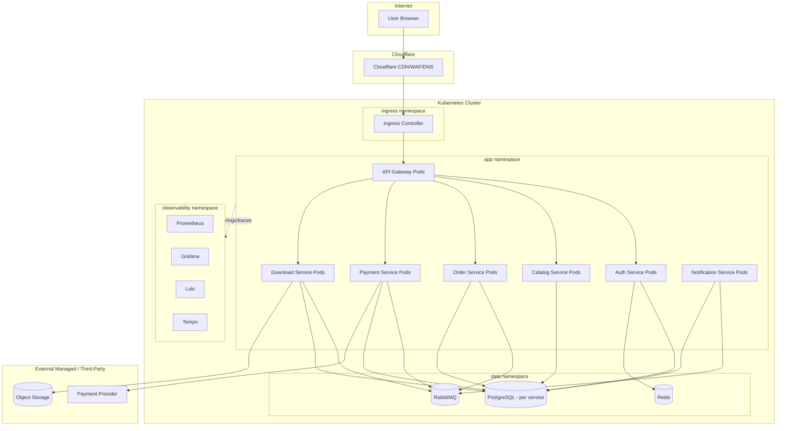

Argo CD (GitOps) mengelola deployment ke cluster ini pada Phase implementasi; Helm chart per service. Detail implementasi tidak dibahas pada Phase 1.
