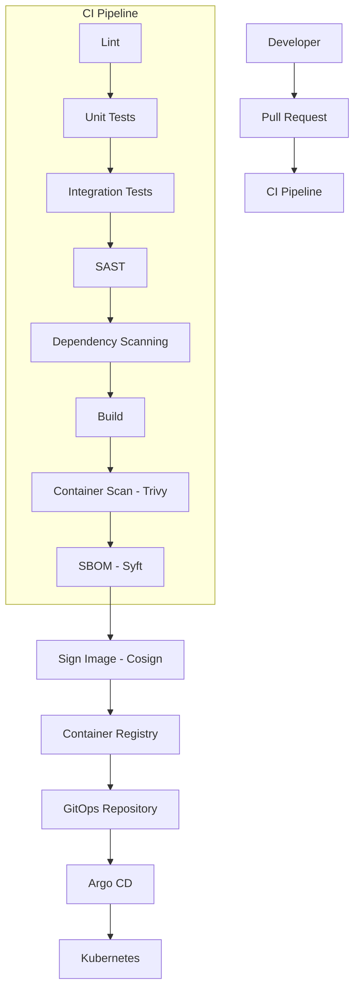

# CI/CD Architecture — CodeShop

## 1. Overview



Prinsip inti: **CI membangun dan memvalidasi**, **GitOps + Argo CD men-deploy** (lihat ADR-011). CI tidak pernah memiliki akses langsung ke cluster produksi.

## 2. PR Pipeline

Berjalan pada setiap Pull Request:

1. Lint (format, static style check).
2. Unit tests per service.
3. Integration tests (service + database/broker lokal, mis. via testcontainer — detail Phase implementasi).
4. SAST (static application security testing) untuk kode yang diubah.
5. Dependency scanning (mendeteksi CVE pada dependency baru/berubah).

Hasil pipeline PR menjadi **gate wajib** sebelum merge — PR tidak dapat digabung jika salah satu tahap gagal (branch protection, dikonfigurasi di Phase implementasi).

**Tidak ada deployment yang terjadi dari PR pipeline** — hanya validasi.

## 3. Main Branch Pipeline

Berjalan setelah merge ke `main`:

1. Seluruh tahap PR pipeline diulang pada kode hasil merge (memastikan tidak ada regressi dari race condition antar PR).
2. Build container image per service yang berubah.
3. Container scan (Trivy) terhadap image hasil build.
4. Generate SBOM (Syft) untuk image.
5. Sign image (Cosign) — memastikan provenance image dapat diverifikasi sebelum deploy.
6. Push image ke Container Registry dengan **immutable tag** (mis. digest atau tag berbasis commit SHA, bukan `latest`).

Image yang lolos tahap ini dianggap **release candidate**, belum otomatis dideploy ke produksi.

## 4. Release Pipeline (Staging → Production)

```text
Release Candidate Image
   ↓
Update GitOps repo (staging overlay) → Argo CD sync → Staging
   ↓
Automated smoke test / verification di Staging
   ↓
Manual approval (promotion gate)
   ↓
Update GitOps repo (production overlay) → Argo CD sync → Production
```

- **Staging** menerima deployment otomatis setelah image lolos main branch pipeline (continuous deployment ke staging).
- **Production** memerlukan **approval eksplisit** (promotion gate) — bukan continuous deployment penuh, mengingat sifat bisnis (pembayaran, data user nyata) yang memerlukan kontrol manusia di titik ini pada tahap kematangan tim saat ini. Ini dapat dievaluasi ulang menjadi lebih otomatis setelah confidence pada test coverage & observability meningkat (dicatat sebagai future improvement, bukan keputusan permanen).
- Promosi ke production dilakukan dengan **image digest yang sama persis** yang sudah diverifikasi di staging (tidak ada rebuild) — memastikan apa yang diuji adalah apa yang dideploy (artifact immutability).

## 5. Rollback

- Rollback dilakukan melalui **Git revert** pada GitOps repository (mengembalikan referensi image/values ke versi sebelumnya), bukan `kubectl rollout undo` manual — konsisten dengan prinsip GitOps (ADR-011): state di cluster harus selalu mencerminkan Git.
- Karena tag image immutable dan disimpan permanen di registry (dengan kebijakan retensi, lihat `TRADE_OFFS.md`), rollback selalu dapat merujuk ke digest image yang valid dan sudah pernah lolos scan/sign sebelumnya.

## 6. Approval & Promotion

| Tahap | Trigger | Approval |
|---|---|---|
| PR → main | Merge PR | Review kode (peer review) + seluruh CI check hijau |
| main → staging | Otomatis setelah build & scan lolos | Tidak ada approval manual (continuous deployment ke staging) |
| staging → production | Manual | Approval eksplisit dari maintainer/owner project |

## 7. Artifact Immutability

- Image di-tag menggunakan commit SHA/digest, tidak pernah menggunakan tag mutable (`latest`, `stable`) di manifest deployment.
- Manifest deployment (Helm values di GitOps repo) selalu mereferensikan digest spesifik, bukan tag mengambang — mencegah "deployment drift" akibat tag yang direassign ke image berbeda di registry.

## 8. Security Gates Summary

| Gate | Tahap | Blocking? |
|---|---|---|
| Lint/unit/integration test | PR | Ya |
| SAST | PR | Ya |
| Dependency scanning | PR & main | Ya (severity tinggi/kritis memblokir) |
| Container scan (Trivy) | main (setelah build) | Ya (severity tinggi/kritis memblokir push ke registry) |
| SBOM generation | main | Tidak blocking, tetapi wajib ada sebelum sign |
| Image signing (Cosign) | main | Ya (image tanpa signature valid tidak dapat di-deploy — diverifikasi oleh admission policy di Kubernetes, Phase implementasi) |

## 9. What This Phase Does Not Cover

Konfigurasi konkret (file YAML workflow GitHub Actions, Argo CD Application manifest, dsb.) **tidak** dibuat pada Phase 1.1 — dokumen ini hanya mendefinisikan arsitektur target. Implementasi adalah scope Phase 5 (CI) dan Phase 7 (CD/GitOps) sesuai roadmap di `README` fase (lihat `ARCHITECTURE.md` pembukaan/konteks fase).

## 10. Production Deployment Strategy

```text
Development
   ↓
CI
   ↓
Container Registry
   ↓
Staging
   ↓
Automated Verification
   ↓
Production
```

### Perbandingan Strategi

| Strategi | Deskripsi | Cocok untuk CodeShop? |
|---|---|---|
| **Rolling deployment** | Pod lama digantikan pod baru secara bertahap, dengan readiness probe memastikan pod baru sehat sebelum pod lama dimatikan. | **Dipilih sebagai strategi awal.** Native di Kubernetes tanpa tooling tambahan, cukup aman untuk service stateless dengan health check yang baik, dan proporsional untuk skala tim/trafik saat ini. |
| **Blue/green** | Environment baru (green) disiapkan penuh di samping environment lama (blue), trafik dialihkan sekaligus setelah verifikasi. | Memberi rollback instan dan isolasi penuh, tetapi memerlukan dua kali resource selama transisi dan kompleksitas routing tambahan — dipertimbangkan sebagai **peningkatan Future** untuk service dengan risiko deployment tinggi (mis. Payment Service) setelah tim memiliki confidence dan tooling routing yang matang, bukan diadopsi sejak awal. |
| **Canary** | Sebagian kecil trafik diarahkan ke versi baru terlebih dahulu, dinaikkan bertahap sambil dipantau. | Memberi deteksi dini masalah dengan dampak terbatas, tetapi memerlukan traffic-splitting capability (service mesh/ingress canary) dan observability yang matang untuk membuat keputusan otomatis/manual menaikkan trafik — dicatat sebagai **peningkatan Future**, terutama relevan untuk endpoint kritikal (checkout/payment) begitu volume trafik cukup besar untuk membuat canary bermakna secara statistik. |

### Rollback

- Rolling deployment di Kubernetes secara native mendukung rollback ke ReplicaSet sebelumnya, tetapi CodeShop **tidak** menggunakan `kubectl rollout undo` manual — rollback dilakukan via **Git revert** pada GitOps repository (`CI_CD_DESIGN.md` §5), memastikan state cluster selalu selaras dengan Git dan rollback tercatat sebagai perubahan yang diaudit.
- Karena artifact immutable (§7) dan setiap release melewati staging terlebih dahulu (§4), versi sebelumnya yang di-revert selalu merupakan versi yang **sudah pernah terbukti berjalan baik**, bukan versi yang belum pernah diuji.
