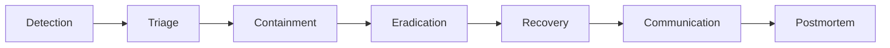

# Incident Response — CodeShop

## 1. Incident Severity

| Severity | Definisi | Contoh |
|---|---|---|
| **SEV-1 (Critical)** | Layanan inti tidak dapat digunakan, atau ada kebocoran/insiden keamanan aktif | Checkout/payment down total, kebocoran data pembayaran, unauthorized mass download terdeteksi. |
| **SEV-2 (High)** | Fungsi penting terganggu signifikan tetapi ada sebagian layanan yang tetap berjalan | Payment webhook gagal diproses (order stuck di PENDING_PAYMENT), Download Service error rate tinggi. |
| **SEV-3 (Medium)** | Gangguan terbatas, dampak dapat di-mitigasi sementara | Notification Service down (email tertunda), cache degradation. |
| **SEV-4 (Low)** | Anomali kecil, tidak berdampak langsung ke user | Alert non-kritikal, tren metric yang perlu diamati. |

## 2. Lifecycle

### Detection
- Sumber deteksi: alert otomatis (`OBSERVABILITY.md` §6), laporan user, atau temuan proaktif tim.
- Setiap alert Critical/High otomatis membuka insiden (bukan menunggu konfirmasi manual berlarut-larut).

### Triage
- Menentukan severity (§1), dampak (siapa/apa yang terpengaruh), dan apakah insiden bersifat keamanan (memerlukan penanganan khusus, lihat §5) atau operasional murni.

### Containment
- Langkah cepat untuk membatasi dampak lebih lanjut **tanpa** menunggu root cause penuh diketahui — contoh: menonaktifkan sementara endpoint yang disalahgunakan, me-revoke kredensial yang dicurigai bocor, menghentikan sementara konsumsi event yang menyebabkan efek samping salah.
- Untuk insiden download tidak sah: revoke entitlement/signed URL terkait sesegera mungkin (lihat `ARCHITECTURE.md` §10 Entitlement revocation) dan invalidasi kredensial object storage jika kompromi lebih luas dicurigai.

### Eradication
- Menghilangkan akar penyebab (mis. men-deploy fix, memperbaiki konfigurasi, mencabut akses yang disusupi secara permanen).

### Recovery
- Mengembalikan layanan ke kondisi normal, memverifikasi melalui observability (`OBSERVABILITY.md`) bahwa golden signals kembali ke baseline sebelum insiden dianggap selesai.

### Communication
- Update berkala ke stakeholder internal selama insiden berlangsung (frekuensi disesuaikan severity — SEV-1 lebih sering).
- Untuk insiden yang berdampak ke user (downtime, kebocoran data), komunikasi eksternal mengikuti kebijakan yang proporsional terhadap dampak nyata dan kewajiban hukum yang berlaku, disusun oleh pemilik produk/bisnis, bukan hanya tim teknis.

### Postmortem
- Wajib untuk SEV-1 dan SEV-2, direkomendasikan untuk SEV-3.
- Blameless — fokus pada perbaikan sistem/proses, bukan mencari kesalahan individu.
- Menghasilkan action item konkret dengan pemilik dan target waktu, ditindaklanjuti sebagai bagian dari backlog teknis.

## 3. Evidence Preservation

Untuk insiden yang berpotensi keamanan (kompromi kredensial, unauthorized access, dsb.):

- Log dan data terkait insiden **tidak dihapus/dirotasi** sebelum investigasi selesai, meskipun retensi normal (`DATA_CLASSIFICATION.md`) mengizinkan penghapusan.
- Snapshot state sistem (jika relevan) diambil sebelum containment mengubah kondisi lebih lanjut, sejauh tidak menghalangi upaya containment yang mendesak.
- Akses ke evidence dibatasi ke tim yang menangani investigasi (chain of custody sederhana), konsisten dengan prinsip akses audit log yang ketat di `DATA_CLASSIFICATION.md`.

## 4. Example Incidents & Response Outline

### Payment outage (webhook tidak dapat diproses / provider down)
- Deteksi: alert latency/error rate webhook (`OBSERVABILITY.md`).
- Containment: aktifkan mode degradasi (checkout tetap menerima order, tetapi user diberi tahu proses pembayaran mungkin tertunda); tidak menghentikan penerimaan order baru kecuali provider benar-benar tidak dapat diakses.
- Recovery: jalankan reconciliation job (lihat `ARCHITECTURE.md` §9) untuk menyamakan status setelah provider pulih.

### Unauthorized download terdeteksi
- Deteksi: alert abuse pattern (`OBSERVABILITY.md` §6) atau laporan pemilik produk.
- Containment: revoke entitlement/signed URL terkait, blokir sementara akun yang terlibat jika ada indikasi kompromi akun.
- Eradication: perbaiki celah otorisasi jika ditemukan bug (lihat `THREAT_MODEL.md` §Download).
- Postmortem: evaluasi apakah rate limit/policy download perlu diperketat.

### Database outage
- Deteksi: readiness probe gagal, alert saturasi/koneksi database.
- Containment: failover ke replica jika tersedia (lihat `DATABASE_DESIGN.md` §11 Replication) atau restore dari backup terbaru sesuai `BACKUP_STRATEGY.md`.
- Recovery: verifikasi RPO/RTO tercapai sesuai target `DISASTER_RECOVERY.md`.

### Kubernetes outage
- Deteksi: multiple pod/service unhealthy bersamaan, node not ready.
- Containment: evaluasi apakah kegagalan node tunggal (self-healing otomatis cukup) atau kegagalan cluster-wide (memerlukan eskalasi ke prosedur DR, `DISASTER_RECOVERY.md` §5).

### Credential compromise
- Deteksi: aktivitas anomali pada credential (mis. akses dari lokasi/pola tidak wajar), atau laporan kebocoran (mis. secret ter-commit ke Git publik).
- Containment: revoke/rotate credential yang terlibat **segera** (lihat ADR-013 untuk mekanisme rotasi), audit akses yang menggunakan credential tersebut selama window kompromi.
- Eradication: identifikasi bagaimana credential bocor, tutup celahnya (mis. pre-commit hook jika bocor via Git).

### Container vulnerability (CVE kritis ditemukan pasca-deploy)
- Deteksi: scan berkala (Trivy) menemukan CVE baru pada image yang sudah berjalan (bukan hanya di CI, lihat `TRADE_OFFS.md` untuk scanning runtime sebagai peningkatan Future).
- Containment: evaluasi eksploitabilitas nyata pada konfigurasi CodeShop; jika berisiko tinggi, percepat patch/rebuild image dan deploy ulang via jalur GitOps normal (bukan hotfix manual ke cluster).

### Message broker outage
- Deteksi: alert queue depth/consumer lag, koneksi broker gagal.
- Containment: layanan sinkron (checkout, payment, download) tetap berjalan (tidak bergantung langsung pada broker untuk jalur kritikal, lihat `ARCHITECTURE.md` §9); fitur asynchronous (notifikasi, optimasi entitlement) tertunda hingga broker pulih.

## 5. Security-Specific Handling

Insiden yang teridentifikasi sebagai insiden keamanan (bukan sekadar outage operasional) mengikuti langkah tambahan: containment lebih agresif (termasuk kemungkinan mengisolasi service yang terlibat), evidence preservation (§3) diprioritaskan di atas kecepatan recovery semata, dan postmortem wajib mencakup update terhadap `THREAT_MODEL.md` jika ancaman yang terjadi belum terdaftar di sana.
