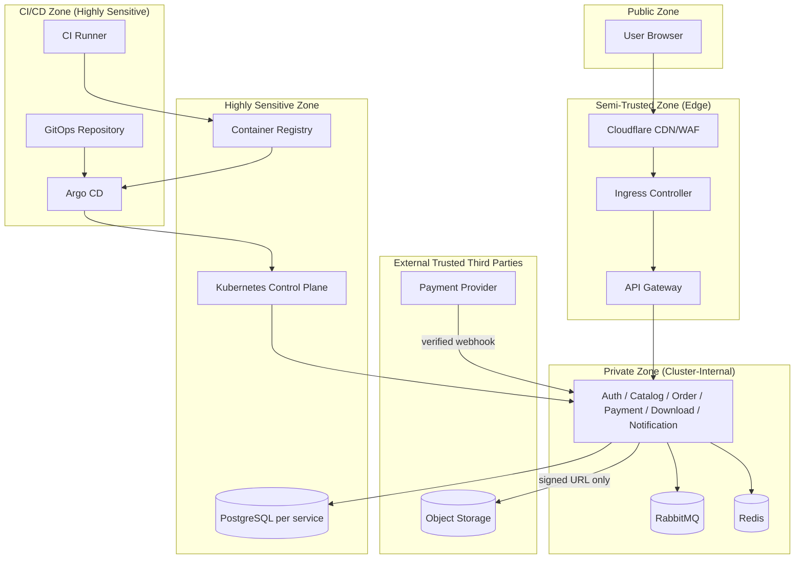

# Network Architecture — CodeShop

## 1. High-Level Traffic Path

```text
Internet
   ↓
Cloudflare (CDN / WAF / DNS / DDoS protection)
   ↓
Firewall (cloud provider network ACL / security group)
   ↓
Ingress (Kubernetes)
   ↓
API Gateway
   ↓
Internal Services (gRPC, cluster-internal only)
   ↓
Private Data Layer (PostgreSQL, Redis, RabbitMQ, Object Storage)
```

## 2. Zero-Trust / Least-Trust Principles Applied

CodeShop tidak mengklaim "full zero-trust" (yang memerlukan mTLS penuh, identity-aware proxy di setiap hop, dsb. — kompleksitas yang belum proporsional untuk skala tim ini), tetapi menerapkan prinsip **least-trust** yang realistis:

- Tidak ada komponen internal yang secara default dipercaya hanya karena berada "di dalam jaringan" — setiap service tetap memvalidasi identitas pemanggil (JWT untuk request yang berasal dari user, mTLS/network policy untuk service-to-service).
- Setiap hop jaringan dibatasi hanya untuk arah/tujuan yang benar-benar dibutuhkan (NetworkPolicy default-deny, lihat `KUBERNETES_DESIGN.md` §7), bukan flat network.
- Kredensial/akses tidak pernah bersifat permanen tanpa batas untuk resource sensitif (signed URL berumur pendek, token JWT berumur pendek).

## 3. Trust Zone Diagram



**Klasifikasi zona**:

- **Public**: internet, browser user — sepenuhnya tidak dipercaya.
- **Semi-Trusted**: Cloudflare edge, Ingress, API Gateway — menerima trafik publik langsung, tetapi tidak menyimpan data sensitif dan tidak menjadi otoritas otorisasi (lihat `ARCHITECTURE.md` §11a).
- **Private**: service aplikasi, message broker, cache — cluster-internal, tidak dapat diakses dari luar.
- **Highly Sensitive**: database per service, container registry, Kubernetes control plane, CI/CD & GitOps repository — kompromi di zona ini berdampak sangat luas (kebocoran data massal atau supply-chain compromise), sehingga mendapat kontrol akses paling ketat.
- **External Trusted Third Parties**: payment provider dan object storage — dipercaya sebatas kontrak/API yang terverifikasi (signature webhook, signed URL), bukan dipercaya penuh secara implisit.

## 4. Traffic Categories

| Kategori | Arah | Kontrol |
|---|---|---|
| Ingress traffic (user → sistem) | Masuk | Cloudflare WAF/DDoS, TLS wajib, rate limiting di Gateway. |
| Egress traffic (sistem → internet) | Keluar | Dibatasi hanya ke domain yang dibutuhkan (payment provider, object storage endpoint, email provider) — bukan egress bebas dari pod aplikasi. |
| Service-to-service traffic | Internal | gRPC melalui NetworkPolicy yang eksplisit per dependency (`SERVICE_CATALOG.md` Dependency Matrix), direncanakan mTLS di Phase implementasi. |
| Database traffic | Internal | Hanya dari service pemilik ke database miliknya (lihat `KUBERNETES_DESIGN.md` §7); tidak ada akses lintas database. |
| Broker traffic (RabbitMQ) | Internal | Hanya dari service yang terdaftar sebagai producer/consumer (`EVENT_DESIGN.md` §4). |
| Object storage traffic | Campuran | Upload/manajemen: hanya dari Catalog/Download Service (kredensial internal). Download: langsung dari client browser ke object storage via signed URL (bypass service aplikasi, lihat `ARCHITECTURE.md` §10). |
| Payment provider traffic | Keluar (create session) + Masuk (webhook) | Keluar: hanya dari Payment Service ke domain provider yang diizinkan. Masuk: webhook endpoint publik tetapi diverifikasi signature (`THREAT_MODEL.md` §Payment). |

## 5. DNS & Edge

- Seluruh domain publik CodeShop berada di belakang Cloudflare (proxy mode), memberikan WAF, DDoS protection, dan caching untuk asset publik (Catalog thumbnail, dsb.) tanpa menyentuh service aplikasi.
- Tidak ada subdomain/endpoint backend yang di-expose langsung tanpa melalui Cloudflare + Ingress.

## 6. What This Phase Does Not Cover

Detail CIDR range, konfigurasi firewall/security group cloud provider spesifik, dan konfigurasi mTLS service mesh (jika dipilih di Phase implementasi) tidak dibuat pada Phase 1.1 — ini adalah spesifikasi arsitektur, bukan konfigurasi infrastruktur.
