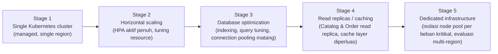

# Trade-offs & Complexity Awareness — CodeShop

## 1. Purpose

CodeShop adalah portfolio project sekaligus produk nyata. Dokumen ini secara sengaja **mengekspos alasan di balik setiap keputusan yang menambah kompleksitas**, agar arsitektur ini terlihat sebagai hasil penilaian teknik (engineering judgment) — memilih level kompleksitas yang tepat untuk konteksnya — bukan sekadar mengumpulkan teknologi populer ("technology collecting").

Setiap komponen diklasifikasikan:

- **Required** — tidak dapat dilewati tanpa mengorbankan requirement inti (`REQUIREMENTS.md`).
- **Recommended** — memberi manfaat signifikan untuk kematangan/keandalan produksi, sebaiknya ada sebelum go-live serius.
- **Optional** — bermanfaat, tetapi dapat ditunda tanpa risiko besar.
- **Future** — hanya relevan pada skala/kematangan yang lebih tinggi dari kondisi saat ini.

## 2. Component-by-Component Assessment

| Komponen | Klasifikasi | Kompleksitas Operasional | Alasan |
|---|---|---|---|
| Microservices (7 service baseline) | **Required** | Menengah–Tinggi | Domain payment/download memerlukan isolasi keamanan; arah tim eksplisit menuju Kubernetes/cloud-native (`ADR-001`). |
| Database per service | **Required** | Menengah | Konsekuensi langsung dari microservices; alternatif (shared DB) menghilangkan manfaat isolasi (`ADR-002`). |
| PostgreSQL | **Required** | Rendah–Menengah | Kebutuhan ACID untuk data transaksional (`ADR-006`). |
| Redis | **Recommended** | Rendah | Signifikan untuk performa (cache, session), tetapi sistem tetap fungsional tanpa Redis dalam mode degradasi (`RELIABILITY.md` §8) — bukan hard dependency absolut. |
| RabbitMQ | **Required** | Menengah | Decoupling Payment↔Order↔Download↔Notification adalah inti dari koreksi ownership Phase 1.1 (`EVENT_DESIGN.md` §1a); tanpa broker, ownership boundary yang bersih sulit dipertahankan tanpa distributed transaction yang lebih kompleks. |
| Object storage (MinIO/S3) | **Required** | Menengah | Inti dari model bisnis (produk digital) dan keamanan download (`ADR-008`, `ADR-009`). |
| Kubernetes | **Recommended → Required untuk Production Baseline** | Tinggi | Signifikan overhead operasional untuk tim kecil; **direkomendasikan** dimulai dari managed Kubernetes (bukan self-managed) untuk menurunkan beban operasional sambil tetap mendapat manfaat orkestrasi (`ADR-010`). Docker Compose cukup untuk Local (`ENVIRONMENT_STRATEGY.md`). |
| Helm | **Required** (mengikuti Kubernetes) | Rendah–Menengah | Standar de facto untuk mengelola manifest Kubernetes yang berulang lintas environment. |
| GitHub Actions (CI) | **Required** | Rendah–Menengah | Kebutuhan dasar automated testing & build sebelum deploy apa pun. |
| Argo CD (GitOps) | **Recommended** | Menengah | Memberi audit trail dan drift detection yang berharga, tetapi tim kecil secara teknis bisa memulai dengan CI-driven deploy sederhana lebih dulu dan mengadopsi Argo CD begitu Kubernetes stabil (`ADR-011`) — tidak dianggap blocking untuk Phase awal implementasi jika waktu terbatas. |
| Prometheus + Grafana | **Required** | Menengah | Tanpa observability dasar, mendiagnosis insiden produksi (`INCIDENT_RESPONSE.md`) menjadi sangat sulit — dianggap non-negotiable untuk Production Baseline. |
| Loki | **Recommended** | Rendah–Menengah | Log correlation sangat membantu, tetapi tim dapat memulai dengan log terstruktur ke stdout + agregasi sederhana sebelum Loki penuh terpasang. |
| OpenTelemetry + Tempo | **Recommended** | Menengah–Tinggi | Distributed tracing bernilai tinggi untuk sistem microservices, tetapi merupakan investasi instrumentasi yang dapat ditambahkan bertahap per service (dimulai dari alur kritikal: checkout→payment→download) daripada wajib penuh di hari pertama. |
| Alertmanager | **Required** (mengikuti Prometheus) | Rendah | Tanpa alerting, monitoring hanya bersifat pasif/reaktif terlambat. |
| Trivy (container scanning) | **Required** | Rendah | Biaya rendah, manfaat keamanan tinggi — mudah diadopsi sejak awal CI (`ADR-014`). |
| Syft (SBOM) | **Recommended** | Rendah | Nilai penuh SBOM terasa saat insiden supply-chain terjadi; murah untuk diaktifkan sejak awal meski manfaat langsungnya tidak selalu terlihat harian. |
| Cosign (image signing) | **Recommended** | Rendah–Menengah | Signifikan untuk memastikan provenance, tetapi penegakan penuh (admission policy menolak image tak bertanda tangan) dapat menyusul setelah pipeline dasar stabil. |
| Cloudflare (CDN/WAF) | **Required** | Rendah (managed) | Biaya operasional rendah (layanan terkelola) dengan manfaat keamanan/performa signifikan di edge. |
| mTLS internal penuh / service mesh | **Future** | Tinggi | Nilai zero-trust penuh nyata, tetapi kompleksitas operasional (sidecar, sertifikat) tidak proporsional untuk skala tim saat ini; NetworkPolicy + gRPC TLS titik-ke-titik sudah memberi sebagian besar manfaat dengan biaya jauh lebih rendah (`NETWORK_DESIGN.md` §2). |
| Multi-region deployment | **Future** | Sangat Tinggi | Di luar Non-Goals (`REQUIREMENTS.md`); hanya relevan setelah volume bisnis/SLA menuntutnya (`DISASTER_RECOVERY.md` §6). |
| Runtime vulnerability scanning (bukan hanya CI) | **Future** | Menengah | Manfaat inkremental di atas scanning CI; relevan setelah permukaan produksi cukup besar untuk drift CVE pasca-deploy menjadi risiko nyata. |
| Canary/blue-green deployment | **Future** | Tinggi | Lihat `CI_CD_DESIGN.md` §10 — rolling deployment sudah memadai pada volume trafik saat ini. |
| Ephemeral per-PR preview environment | **Future/Optional** | Menengah | Nilai jelas untuk tim besar dengan banyak PR paralel; kurang proporsional untuk tim kecil (`ENVIRONMENT_STRATEGY.md` §6). |

## 3. Scalability Roadmap

- **Stage 1** adalah target Production Baseline dokumen ini — cukup untuk melayani volume transaksi awal.
- **Stage 2–3** dipicu oleh data observability nyata (bukan spekulasi) — mis. HPA diaktifkan penuh saat pola trafik jam sibuk teramati; optimasi database dilakukan saat query latency mendekati SLO (`OBSERVABILITY.md` §3).
- **Stage 4–5** relevan hanya jika bisnis tumbuh signifikan; mendesain untuk stage ini sejak hari pertama (mis. read replica untuk seluruh database, multi-region) akan menjadi **over-engineering** yang eksplisit dihindari oleh dokumen ini — CodeShop **tidak** didesain untuk jutaan pengguna kecuali kebutuhan itu benar-benar muncul dan terjustifikasi oleh data.

## 4. Explicit Anti-Goals (Restated)

Untuk menghindari scope creep di fase implementasi mendatang, berikut diulang secara eksplisit sebagai pengingat bahwa kompleksitas berikut **sengaja tidak dikejar** pada tahap ini: Cart sebagai service terpisah, search engine terpisah, multi-seller marketplace, service mesh penuh, multi-region active-active, canary/blue-green deployment sejak awal, dan cluster Development terpisah dari Local/Staging (lihat detail masing-masing di dokumen sumber terkait: `ARCHITECTURE.md`, `decisions/README.md`, `ENVIRONMENT_STRATEGY.md`).
